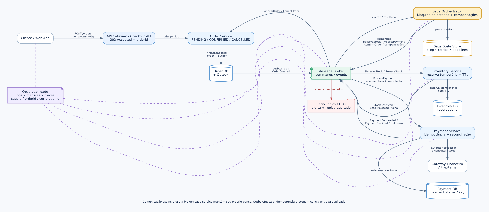
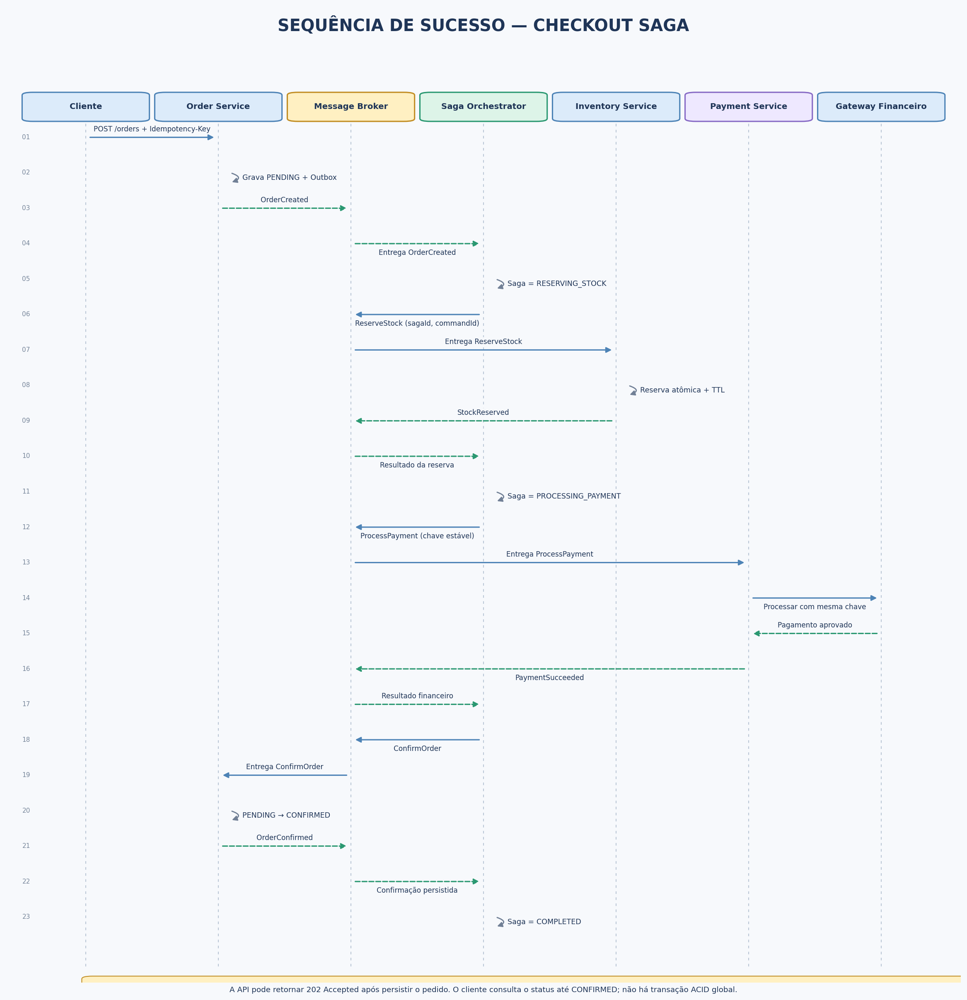
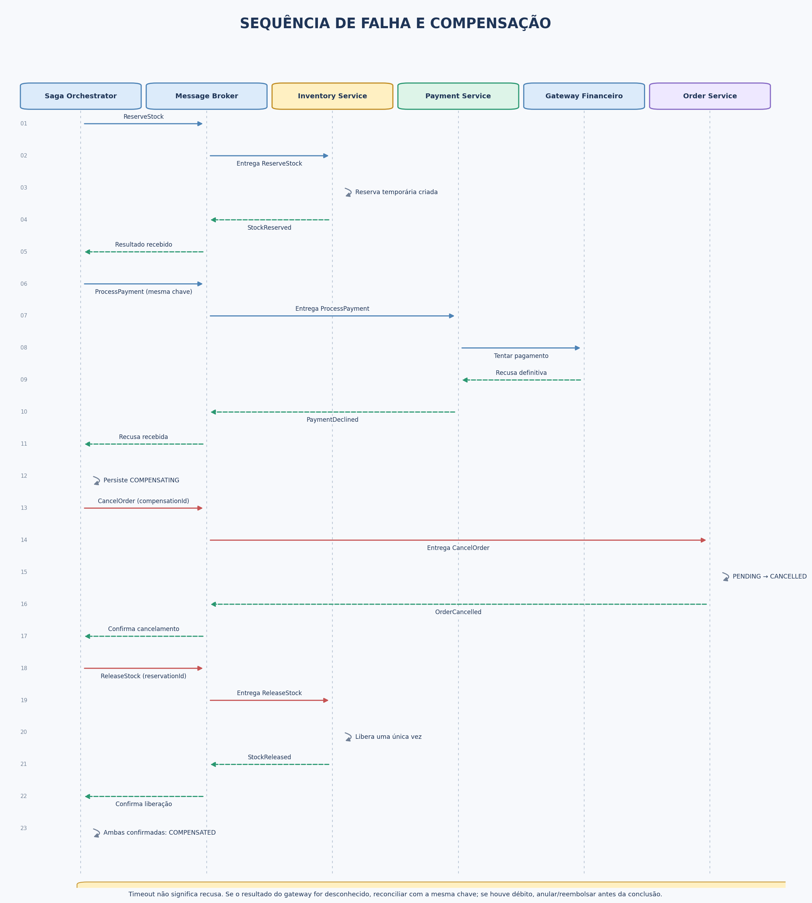

# Blueprint de Arquitetura — Saga para Checkout Distribuído

## Contexto de negócio

Esta blueprint descreve a migração do fluxo de compra de um monólito para três microsserviços com bancos independentes: **Order Service**, **Inventory Service** e **Payment Service**. Como não existe uma transação ACID única envolvendo todas as bases e o gateway financeiro, a consistência do checkout é coordenada por uma **Saga**, composta por transações locais e ações compensatórias.

**Decisão principal:** utilizar Saga por **orquestração**, com um Saga Orchestrator persistente e mensageria assíncrona. O orquestrador controla o estado, publica comandos e reage aos resultados sem exigir chamadas síncronas encadeadas entre todos os serviços.

## Caminho de sucesso

1. O cliente solicita a criação do pedido com uma chave de idempotência.
2. O Order Service grava o pedido como `PENDING` e um registro de outbox na mesma transação local.
3. O relay publica `OrderCreated`; o orquestrador cria o estado da Saga.
4. O orquestrador envia `ReserveStock`. O Inventory Service cria uma reserva temporária idempotente e publica `StockReserved`.
5. Após confirmar a reserva, o orquestrador envia `ProcessPayment`. O Payment Service chama o gateway com uma chave idempotente e publica `PaymentSucceeded` ou `PaymentDeclined`.
6. Após `PaymentSucceeded`, o orquestrador envia `ConfirmOrder`. O Order Service atualiza o pedido para `CONFIRMED`.
7. O orquestrador registra a Saga como `COMPLETED`.

O fluxo é assíncrono após a aceitação inicial do pedido. A API pode responder `202 Accepted` com `orderId` e um endpoint de consulta de status, evitando prometer que o checkout inteiro será concluído dentro de uma chamada HTTP.

## Caminho de falha

Se o pagamento for **recusado definitivamente** após a reserva de estoque, o orquestrador muda a Saga para `COMPENSATING` e envia duas compensações idempotentes: `CancelOrder` e `ReleaseStock`. Quando ambas forem confirmadas, a Saga passa para `COMPENSATED` e o pedido fica cancelado.

Um timeout do pagamento **não equivale a recusa**. O gateway pode ter processado a transação e a resposta ter sido perdida. Nesse caso, a Saga entra em `PAYMENT_UNKNOWN`, consulta o estado da transação e repete apenas com a mesma chave de idempotência. Se for necessário abandonar o fluxo após a reconciliação, uma autorização/captura bem-sucedida deve ser anulada ou reembolsada antes de considerar a compensação financeira concluída.

## Estrutura do repositório

```text
.
├── README.md
├── diagrams/
│   ├── saga-architecture-overview.png
│   ├── sequence-success-flow.png
│   ├── sequence-compensation-flow.png
│   ├── saga-architecture-overview.dot
│   ├── sequence-success-flow.mmd
│   └── sequence-compensation-flow.mmd
└── docs/
    └── decisoes-arquiteturais.md
```

Os PNGs são as versões prontas para leitura. Os arquivos `.dot` e `.mmd` são as fontes editáveis dos diagramas. Os diagramas Mermaid podem ser visualizados em plataformas que suportem Mermaid, incluindo o GitHub.

## Diagramas

### Visão geral da arquitetura



### Sequência de sucesso



### Falha e compensação



## Como visualizar e editar

- Abra os PNGs diretamente no GitHub para consultar os diagramas.
- Edite `diagrams/saga-architecture-overview.dot` com Graphviz ou converta-o com `dot -Tpng saga-architecture-overview.dot -o saga-architecture-overview.png`.
- Edite os arquivos `.mmd` em um editor compatível com Mermaid e regenere as imagens em uma ferramenta que suporte exportação Mermaid para PNG/SVG.
- Consulte `docs/decisoes-arquiteturais.md` para contratos, transições de estado, idempotência, retries, DLQ, observabilidade e riscos.

## Limites e premissas

Esta é uma blueprint de referência, não uma implementação executada. O cenário e os diagramas descrevem o comportamento esperado. Limites de timeout, tentativas, TTL de reserva, SLOs e políticas de retenção devem ser calibrados a partir de requisitos e medições reais. Não é alegado que testes de carga ou de falha tenham sido realizados.
